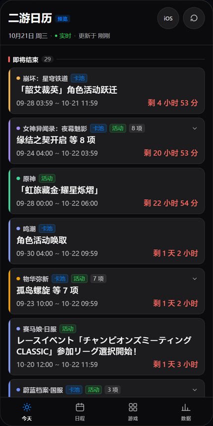
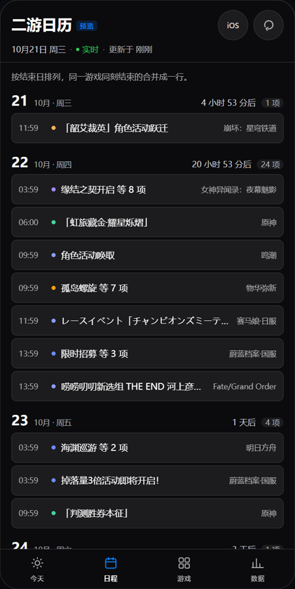
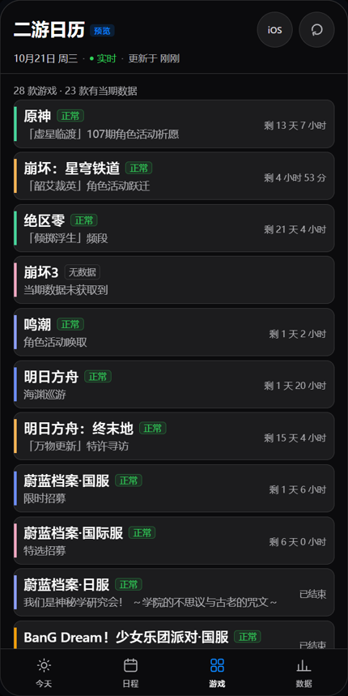
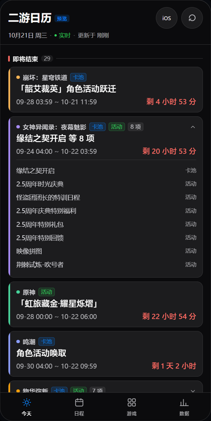
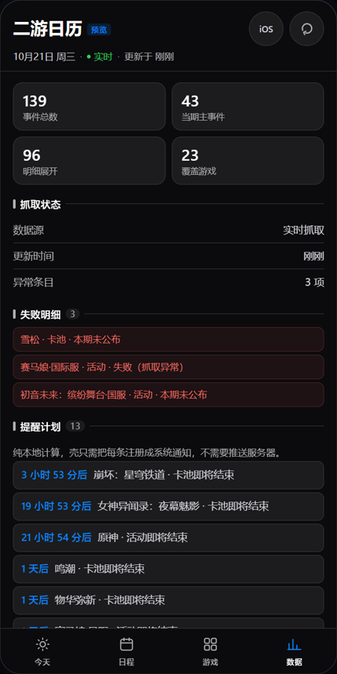
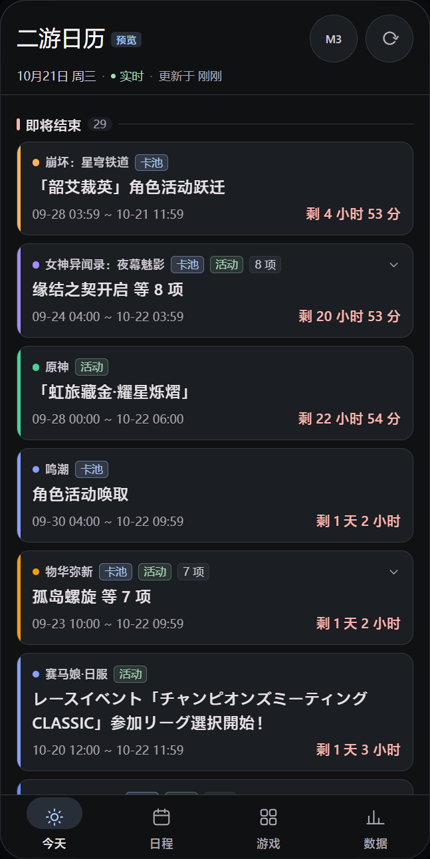
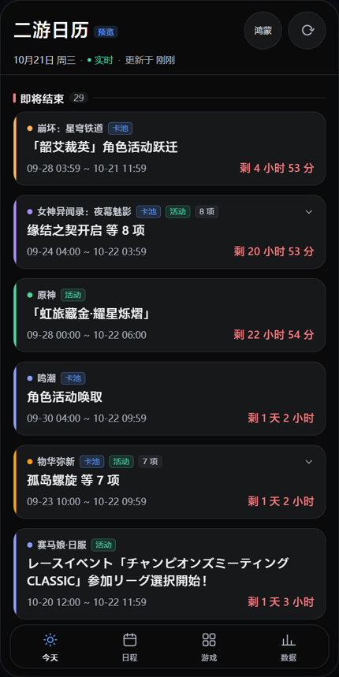

# 二游日历 · App（gacha-calendar-app）

二次元手游的**卡池 / 活动排期**移动端 App，目标覆盖 **Android / iOS / HarmonyOS** 三端。

> **当前阶段：地基已就绪，三端壳待定。**
> 本仓库现在交付的是**可验证的共享核心层** + **浏览器预览**，
> 还不是可以直接装到手机上的 App。为什么这样排期，见 [`docs/PLATFORM-DECISION.md`](docs/PLATFORM-DECISION.md)。

<table>
  <tr>
    <td align="center"><br /><sub><b>今天</b> · 三段聚合</sub></td>
    <td align="center"><br /><sub><b>日程</b> · 按结束日</sub></td>
    <td align="center"><br /><sub><b>游戏</b> · 28 款状态</sub></td>
  </tr>
  <tr>
    <td align="center"><br /><sub><b>点按展开</b> · 同刻结束的明细</sub></td>
    <td align="center"><br /><sub><b>数据健康</b> · 失败与提醒</sub></td>
    <td></td>
  </tr>
</table>

以上均为浏览器预览实拍，数据是**真实抓取**的（2026-10-20，28 款游戏、139 个事件）。

界面有一条与桌面端不同的核心规则：**按「游戏 + 同一结束时刻」归组**。
实测同一款游戏常有 6–8 条活动在同一秒结束，逐条平铺会变成一堵重复的墙；
归组后一张卡代表"这款游戏这批东西什么时候结束"，点开才展开明细。

### 同一屏，按三端官方规范渲染

<table>
  <tr>
    <td align="center"><br /><sub><b>iOS</b> · 17pt 标题 · 44 触控</sub></td>
    <td align="center"><br /><sub><b>Material 3</b> · 64 导航 · 胶囊指示器</sub></td>
    <td align="center"><br /><sub><b>鸿蒙</b> · 16 圆角 · 悬浮胶囊导航</sub></td>
  </tr>
</table>

这些不是只换了配色：字号体系、卡片圆角（12 / 12 / **16**）、卡片间距、底部导航
（58 全宽 / **64** 全宽 + 56×32 指示器 / **56 悬浮胶囊**）、触控目标（44 / 48 / 48）
都按各自官方规范取值，逐项可在 [`docs/DESIGN.md`](docs/DESIGN.md) 追到出处。
数值不是靠眼睛调的 —— `apps/preview/test/design.test.ts` 把**对比度、触控目标、字号下限**
写成断言（28 条），改配色时跌破规范会直接测试失败。

---

## 这是什么

这是同系列第三个前端：

| 仓库 | 形态 | 状态 |
|---|---|---|
| [`dsh-gacha-calendar`](https://github.com/EastMG/dsh-gacha-calendar) | DeepSeek Harness 桌面插件（28 款，**core 的真源**） | 已发布 |
| [`gacha-calendar-extension`](https://github.com/EastMG/gacha-calendar-extension) | Chrome / Edge MV3 扩展（11 款） | 已发布 |
| **本仓库** | Android / iOS / HarmonyOS App | **地基阶段** |

三者共用同一个抓取核心 [`gacha-calendar-core`](https://www.npmjs.com/package/gacha-calendar-core)
（零依赖、零宿主依赖，`createEngine({ transport, storage, now })`）。
**源站改版只需修上游一处**，本仓库不复制任何抓取逻辑。

---

## 快速开始

```bash
npm install

npm run dev        # 打开 http://127.0.0.1:4321 （会先用内置快照渲染，再后台实时刷新）
npm run check      # 类型检查 + 编译 + 96 个测试
npm test           # 只跑测试
```

要求 Node ≥ 22.6（用到内置 TypeScript 类型擦除，测试无需构建步骤）。

`npm run dev` 会起一个**零依赖**的本地服务器，除静态托管外还提供两个仅开发期使用的端点：

| 端点 | 用途 |
|---|---|
| `/__gacha_proxy` | 浏览器有 CORS 与「Referer 禁改头」限制，抓取要经它中转。**真机不需要**（见下） |
| `/__fixture` | 内置快照，网络不通时也能看到完整版式 |

> ⚠️ `/__gacha_proxy` 是一个不受限的出站通道，只监听 `127.0.0.1`，**绝不能用于生产**。

---

## 架构：三层，平台差异只在最上层

```
┌─ apps/preview/          浏览器预览（原生 ESM，无框架、无打包器）
│    今天 / 日程 / 游戏 / 数据健康
├─ packages/core-bridge/  core 的平台适配：transport / storage / engine 门面
│    三端壳只需提供 { http, storage, now }
└─ packages/schedule/     ★ 本仓库的核心增量：把展示串派生成结构化排期
      时区换算 / 年份推断 / 倒计时 / 分段聚合 / 提醒规划
                ↓
        gacha-calendar-core（上游 npm 包，未改动）
```

**为什么没有框架、没有打包器**：三端壳还没定，UI 用什么写都是暂时的。
只有 `packages/*` 是长期资产，所以它们零框架依赖；预览用原生 ESM + import map
就足以验证"数据层 + 信息架构"，也让 `npm run dev` 不依赖任何构建链。

---

## 已完成的验证（不是"应该能"，是实测）

| 验证项 | 结果 |
|---|---|
| core 在非浏览器运行时跑通 | 28 款全量刷新 **2.5 秒** |
| 移动端是否需自建代理服务器 | **不需要**。`fetchViaProxy` 只是"能设任意 header 的请求"，其存在理由是浏览器 CORS |
| 展示串 → 绝对时刻 | **43/43 逐字符往返一致**（真实快照） |
| 时区换算 | 不依赖 `Intl`/ICU，纯固定偏移整数运算 |
| 事件覆盖面 | 主事件 43 条 → **139–145 条**（`*Hover` 明细多抽出 96–102 条） |
| 时钟依赖 | 全部显式传 `nowMs`，测试可完全复现 |
| 测试 | 96 个，覆盖契约/往返/时区/分桶/提醒/格式/配置/设计规范 |

---

## 三个关键设计决策

### 1. 移动端不需要代理服务器

core 有 `fetchRaw` 与 `fetchViaProxy` 两个方法，看起来像"直连 + 代理"两套通道。
实际上 `fetchViaProxy` 的三个理由——CORS、`Referer` 属于浏览器禁改头、少数站点拦浏览器 UA——
**全部是浏览器限制**。真机走原生 HTTP 时这三条都不成立。

所以三端壳只需要实现**一个能设任意 header 的请求器**，`fetchRaw` 与 `fetchViaProxy`
可以由它同时实现。这已用真实网络逐源验证（含 `uma-global` 的 POST、`ba-cn` 的自定义头）。

### 2. 时区换算不碰 `Intl`

core 内部用 `Intl.DateTimeFormat({ timeZone })`。这在 Node/浏览器没问题，
但在移动端 JS 引擎上是**静默风险**：Hermes 不打包 ICU 而是投影平台能力，
鸿蒙侧是否启用未确认；ICU 缺失时可能**不报错、静默退化成设备时区**，
表现为日服/国际服起止时间整体偏 8–9 小时而界面看起来完全正常。

而本项目覆盖的 28 款只用 3 个时区，且**全部是固定偏移、无夏令时**
（国服 `+480`、日服 `+540`、国际服/UTC `0`）。因此 `packages/schedule` 用纯整数运算，
与 `Intl` 逐毫秒等价但零依赖。详见 [`packages/schedule/src/timezone.ts`](packages/schedule/src/timezone.ts) 顶部说明。

> 代价：将来若接入**有夏令时**的时区（例如欧美服按本地时区而非固定 GMT 偏移），
> 这套算法不再成立，必须换带 tzdata 的方案。

### 3. 不编造精度

源站有时只公布日期（没有时分）。这类事件标 `precision: "day"`，
界面只显示"剩 3 天"，**绝不显示"剩 3 小时 12 分"** —— 否则用户会按它去卡点。
同理，`planReminders()` 只对 `minute` 精度的事件排提醒。

---

## 与桌面端 / 扩展端的差异

移动端不是把桌面表格搬到手机上，它多做了两件桌面端做不到的事：

1. **把 `*Hover` 明细铺开成日程**。桌面端只用它做鼠标悬停提示；
   28 款里能从中多抽出 2–4 倍的事件（43 → 139+），这才是"日历"。
2. **三段聚合**（即将结束 / 进行中 / 即将开启）。
   移动端首屏要回答"我这两天会错过什么"，而不是"28 张游戏卡片横向滑"。

同时移动端**不做**桌面/扩展已有的：自定义条目表单、来源下拉、主题色、排序拖拽
（这些是设置项，三端壳阶段再按平台交互重做）。

---

## 平台状态

| 平台 | 状态 | 说明 |
|---|---|---|
| 浏览器（预览 / PWA） | ✅ 可运行 | 本仓库当前形态 |
| Android | ⏳ 待定壳 | 需 JDK 17 + Android SDK |
| iOS | ⏳ 待定壳 | 需 macOS + Xcode |
| HarmonyOS NEXT | ⏳ 待定壳 | 需 DevEco Studio |

选型调研已完成，推荐与技术依据见 [`docs/PLATFORM-DECISION.md`](docs/PLATFORM-DECISION.md)
（结论：RN 0.82 + RNOH 为主方案，Capacitor + 鸿蒙壳为备选；**本阶段不锁定**）。

---

## 文档

- [`docs/DESIGN.md`](docs/DESIGN.md) —— 三端官方规范取值、共享底座与皮肤差异、符合性断言
- [`docs/ARCHITECTURE.md`](docs/ARCHITECTURE.md) —— 分层、数据流、为什么这样切
- [`docs/DATA-MODEL.md`](docs/DATA-MODEL.md) —— `ScheduleEvent` 模型、时区表、年份推断、实测数字
- [`docs/PLATFORM-DECISION.md`](docs/PLATFORM-DECISION.md) —— 三端壳选型调研与待决事项
- [`docs/COMPLIANCE.md`](docs/COMPLIANCE.md) —— 抓第三方游戏数据的上架风险与规避
- [`docs/ROADMAP.md`](docs/ROADMAP.md) —— 分阶段计划
- [`AGENTS.md`](AGENTS.md) —— 开发流程铁律

---

## 数据来源与声明

数据来自各游戏官网公开公告、bwiki / PRTS 等公开 wiki 的**事实性排期信息**
（起止时间、活动名称）。本项目：

- **非官方**，与任何游戏厂商无关联，不含任何游戏 logo / 角色立绘 / 官方 UI 素材；
- **不**要求登录、不收集账号、不接入任何游戏 API、不提供抽卡记录或概率计算；
- 每条数据保留来源与抓取时间，权利人可要求下架，见 [issue](https://github.com/EastMG/gacha-calendar-app/issues)。

上架合规细节见 [`docs/COMPLIANCE.md`](docs/COMPLIANCE.md)。

## License

MIT
